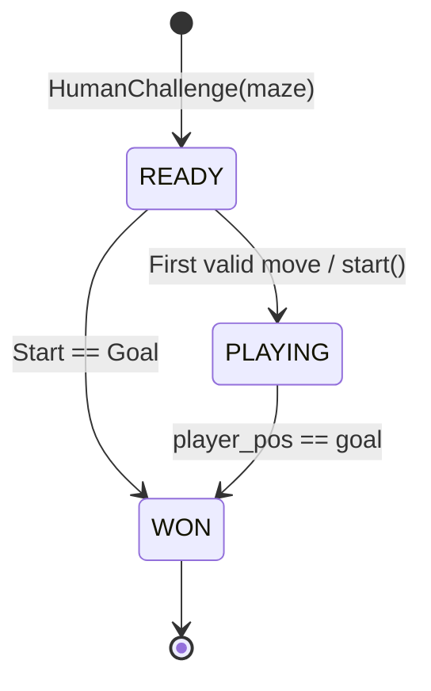

# Academic Project Documentation: AI Maze Solver

## 1. Project Information

| Field | Details |
| :--- | :--- |
| **Institution** | Egyptian E-Learning University (EELU) |
| **Faculty** | Faculty of Computers and Information Technology |
| **Course** | Artificial Intelligence |
| **Academic Term** | Fall 2026–2027 |
| **Project Title** | AI Maze Solver: Search Algorithm Visualization & Human vs AI Challenge Mode |
| **Supervised By** | Dr. Mahmoud Bassiouni |
| **Teaching Assistants** | Eng. George Hany, Eng. Basma Bassem |
| **Implementation Stack** | Python 3, Pygame (`>=2.5.0`), Pytest (`>=8.0.0`) |

---

## 2. Team Members and Algorithmic & Technical Roles

In alignment with the course evaluation framework established by the course instructor and teaching assistants—focusing exclusively on algorithmic depth, computational complexity, data structure efficiency, code-level verification, and system architecture—each team member assumes specialized ownership of a core theoretical and technical domain:

| Student Name | University ID | Algorithmic & Technical Domain | Key Implementation & Technical Responsibilities |
| :--- | :---: | :--- | :--- |
| **Mohamed Hassan Sayed** | `2401354` | **Uninformed Optimal Search & FIFO Queues** | Breadth-First Search (BFS) implementation (`algorithms/bfs.py`), `collections.deque` FIFO queue mechanics with $O(1)$ amortized operations vs $O(N)$ list slicing, mathematical proof of shortest-path optimality on uniform-cost graphs ($c = 1$), cycle prevention via discovered set tracking, authoritative ground truth reference for optimality, and predecessor pointer path reconstruction. |
| **Mohamed Ragab Ahmed** | `2401355` | **Informed Search & Heuristic Formulation** | A\* Search implementation (`algorithms/astar.py`), min-heap priority queue management via `heapq` ($O(\log V)$ insertions/extractions), proof of Manhattan distance admissibility ($h(n) \le h^*(n)$) and consistency (monotonicity) on 4-connected grid graphs, tie-breaking tuple formatting `(f, counter, node)`, and $g$-cost state relaxation. |
| **Moamen Hamouda Gaber** | `2401041` | **State-Space Modeling & Maze Generation** | 2D grid graph state-space formulation (`maze.py`, `mazes/`), procedural maze generation via Iterative Stack-based Randomized Depth-First Search (Recursive Backtracker) constructing a spanning tree, 2-step neighbor carving, loop braiding for cycle introduction, stack-based iteration avoiding recursion limit overflow, and mathematical solvability verification (`has_solution`). |
| **Abdallah Ashraf Farid** | `2401770` | **DFS Asymptotics & Step-by-Step Generators** | Depth-First Search (DFS) implementation (`algorithms/dfs.py`), LIFO stack mechanics, linear space complexity $O(bm)$ vs BFS exponential space $O(b^d)$, non-optimal path analysis, and Python generator architecture (`yield`) in `ui.py` preserving execution context across frame intervals without thread blocking. |
| **Ziad Ahmed AbdelSamee** | `2401040` | **Empirical Benchmarking & Challenge Engine** | Pure search execution timing via `time.perf_counter()` (`benchmark.py`), multi-trial statistical aggregation, Human Challenge Core domain engine and clone isolation (`challenge.py`), and automated differential testing across 3,000 randomized mazes (`tests/`). Code coverage percentage has not been independently measured. |

### 2.1 Technical and Algorithmic Oral Defense Mapping

| Student | Core Algorithmic Focus | Primary Data Structures & Methods | Expected Technical Oral Exam Topics |
| :--- | :--- | :--- | :--- |
| **Mohamed Hassan Sayed** | BFS & Authoritative Optimality Reference | `collections.deque` (`append`, `popleft`), `parent` dict | Why `deque.popleft()` is $O(1)$ vs `list.pop(0)` $O(N)$; formal proof that BFS guarantees shortest path on unweighted unit-cost graphs ($c=1$); why BFS is the sole authoritative reference for human optimality; cycle prevention via set hashing. |
| **Mohamed Ragab Ahmed** | A\* Search & Heuristic Admissibility | `heapq` (`heappush`, `heappop`), `g_score` dict | Mathematical definition of admissibility ($h(n) \le h^*(n)$); proof that Manhattan distance is admissible and consistent on 4-directional grids; why tie-breaking tuples prevent unorderable coordinate comparisons; behavior of A\* when $h(n)=0$ (degenerates to Dijkstra/BFS). |
| **Moamen Hamouda Gaber** | Graph Generation & Spanning Trees | Grid matrix `self.grid`, LIFO stack `stack = [(r, c)]` | Graph theory of spanning trees; how Randomized Backtracker carves unvisited 2-step neighbors and intermediary walls; why an iterative stack in the heap avoids `RecursionError` on large grids ($100 \times 100$); corridor braiding to add alternative cycles. |
| **Abdallah Ashraf Farid** | DFS Space Asymptotics & Generators | LIFO stack `list` (`append`, `pop`), Python `yield` | Space complexity comparison: DFS $O(bm)$ linear space vs BFS $O(b^d)$ exponential space; why DFS can expand fewer nodes on corridor mazes but yields highly sub-optimal paths; mechanics of Python generators (`yield`) freezing execution state per frame. |
| **Ziad Ahmed AbdelSamee** | Benchmark Timing & Challenge Architecture | `time.perf_counter()`, `HumanChallenge`, clone isolation | Isolating pure algorithmic compute time from UI rendering; decoupling domain logic from Pygame; deep clone verification preventing cross-algorithm contamination; mathematical definitions of human moves vs AI nodes expanded; testing oracles. |

---

## 3. Project Idea and AI Problem Formulation

### 3.1 Project Overview

The **AI Maze Solver** is an interactive desktop application designed to formulate, visualize, and empirically compare foundational Artificial Intelligence graph-search algorithms on a 2D grid maze. Finding a collision-free route from a designated Start location to a Goal location inside an obstacle-laden grid models core state-space search problems encountered in autonomous navigation, robotics, and automated planning.

The project incorporates two complementary modes of operation:
1. **Autonomous AI Search Mode**: Provides animated, step-by-step wavefront exploration and synchronous execution for Breadth-First Search (BFS), Depth-First Search (DFS), and A\* Search.
2. **Human vs AI Challenge Mode**: Allows a human user to play and solve the maze manually using real-time keyboard controls, and upon reaching the Goal, compares their performance against BFS, DFS, and A\* executed on identical clones of the active maze snapshot.

### 3.2 Formal AI State-Space Formulation

In classical Artificial Intelligence problem formulation, a deterministic search problem is specified by its state space, initial state, actions, transition model, goal test, and path cost function:

| Problem Component | Mathematical Definition | Implementation in `maze.py`, `challenge.py`, and `algorithms/` |
| :--- | :--- | :--- |
| **Environment Properties** | Fully observable, deterministic, static, discrete, single-agent | 2D grid matrix `self.grid` of dimensions `rows × cols` (`R × C`, where $R \ge 2$ and $C \ge 2$). |
| **State Space ($S$)** | $S = \{(r, c) \mid 0 \le r < R, 0 \le c < C\}$ | Walkable state space $S_{\text{walkable}}$ contains all in-bounds coordinates $(r, c)$ where `grid[r][c] != '#'`. Total grid cells $|S| = R \times C$. |
| **Initial State ($s_0$)** | $s_0 = (r_{\text{start}}, c_{\text{start}}) \in S_{\text{walkable}}$ | Stored in `maze.start` and marked on the grid with character `'S'`. |
| **Goal State ($s_{\text{goal}}$)** | $s_{\text{goal}} = (r_{\text{goal}}, c_{\text{goal}}) \in S_{\text{walkable}}$ | Stored in `maze.goal` and marked on the grid with character `'G'`. |
| **Actions ($A(s)$)** | Orthogonal unit moves in $\{\text{UP}, \text{DOWN}, \text{LEFT}, \text{RIGHT}\}$ | `Maze.get_neighbors(row, col)` and `HumanChallenge.VALID_DIRECTIONS` check deltas $(-1, 0)$, $(1, 0)$, $(0, -1)$, and $(0, 1)$ in that exact order, returning in-bounds non-wall coordinates. |
| **Transition Model** | $\operatorname{Result}((r, c), (dr, dc)) = (r + dr, c + dc)$ | Deterministic transition to the adjacent walkable cell with probability $1.0$. |
| **Goal Test** | $\operatorname{IsGoal}(s) \iff (s == \text{maze.goal})$ | In AI search: evaluated when a node `current` is extracted (popped) from the frontier. In Challenge: evaluated immediately upon arrival at target cell. |
| **Step & Path Cost** | $c(s, a, s') = 1$ for every valid move | Uniform step cost of $1$ per edge. A reconstructed path $P = [s_0, s_1, \dots, s_k]$ has $\operatorname{len}(P)$ cells and a path length of $k = \operatorname{len}(P) - 1$ moves (edges). When $s_0 == s_{\text{goal}}$, $P = [s_0]$ and path length is $0$ moves. |

### 3.3 Path Reconstruction

All three algorithms record traversal history in a dictionary `parent: Dict[Tuple[int, int], Optional[Tuple[int, int]]]` initialized with `{start: None}`. Whenever a neighbor is discovered (in BFS and DFS) or relaxed via a strictly cheaper `g_score` (in A\*), its predecessor is recorded as `parent[neighbor] = current`. Once `current == goal` is popped from the frontier, the solution path is reconstructed by following `parent` pointers backward from `goal` to `start` and reversing the resulting coordinate list.

---

## 4. Algorithms and Theoretical Analysis

### 4.1 Breadth-First Search (BFS)

- **Mechanism (`algorithms/bfs.py`)**: Uses `collections.deque` as a FIFO queue initialized with `[start]`, alongside a `discovered` set (`{start}`) and a `parent` dictionary (`{start: None}`). At each iteration, the oldest node in the frontier is popped from the left via `queue.popleft()` in $O(1)$ amortized time, counted as expanded (`nodes_expanded += 1`), and tested against `goal`. Each walkable neighbor not yet in `discovered` is immediately added to `discovered`, assigned `parent[neighbor] = current`, and appended to the right of `queue` via `queue.append()` in $O(1)$ time.
- **Completeness and Shortest-Path Optimality**: Because the grid state space $|S_{\text{walkable}}| \le R \times C$ is finite and branching factor $b \le 4$ is finite, BFS is **complete** and guaranteed to terminate. Because all orthogonal edges share an identical positive unit cost ($c = 1$), expanding nodes in non-decreasing order of depth guarantees that the first time `goal` is dequeued, it is reached via a path with the minimum possible number of moves. Thus, BFS is **optimal** on unweighted grids and serves as the authoritative ground truth for path optimality across the application.

### 4.2 Depth-First Search (DFS)

- **Mechanism (`algorithms/dfs.py`)**: Uses a standard Python `list` as a LIFO stack initialized with `[start]`, a `discovered` set (`{start}`), and `parent = {start: None}`. In each iteration, `current = stack.pop()` removes the most recently added coordinate from the top of the stack in $O(1)$ amortized time. Walkable neighbors returned by `maze.get_neighbors` (in `Up, Down, Left, Right` order) that are not in `discovered` are marked discovered, linked in `parent`, and pushed onto `stack`. Because of LIFO ordering, the last pushed neighbor is expanded first on the next step.
- **Completeness and Non-Optimality**: Because visited states are tracked in `discovered`, graph-search DFS cannot enter infinite cycles and is **complete** on finite grids. However, DFS is **not optimal**: it commits deeply to arbitrary branches before backtracking, meaning the first path that reaches `goal` is dictated by neighbor push order rather than path cost, often yielding winding routes significantly longer than the shortest path.

### 4.3 A\* Search Algorithm

- **Mechanism (`algorithms/astar.py`)**: Uses Python's `heapq` module to maintain a min-heap priority queue `open_heap` storing tuples `(f_score, counter, node)`, where `counter` is a monotonically increasing integer tie-breaker that prevents Python from comparing coordinate tuples when two nodes share the same `f_score`. It tracks exact path costs from `start` in `g_score: Dict[Tuple[int, int], int] = {start: 0}` and expanded states in `closed_set`.
- **Evaluation Function & Per-Operation Complexity**:
  - $g(n)$: The exact cost (number of moves) accumulated along the best known path from `start` to $n$ (maintained via $O(1)$ dictionary lookups in `g_score`).
  - $h(n)$: The Manhattan heuristic estimate $\operatorname{manhattan\_distance}(a, b) = |a_0 - b_0| + |a_1 - b_1|$, which executes in **$O(1)$** constant time per evaluation.
  - $f(n) = g(n) + h(n)$: The estimated total cost of the cheapest solution path passing through $n$.
  - Priority queue operations (`heapq.heappush` and `heapq.heappop`): **$O(\log V)$** time per heap insertion or extraction, whereas BFS `collections.deque` operations take **$O(1)$** time.
- **Admissibility, Consistency, and Four-Directional Grids**: On a four-directional grid with unit step cost ($c = 1$), moving from $(r_1, c_1)$ to $(r_2, c_2)$ requires at least $|r_1 - r_2|$ vertical steps and $|c_1 - c_2|$ horizontal steps even without obstacles. Thus $h_{\text{Manhattan}}(n) \le h^*(n)$ (admissible), and for any orthogonal step to $n'$, $|h(n) - h(n')| = 1 \le c(n, a, n')$, so $h(n) \le c(n, a, n') + h(n')$ (consistent).
- **Conditions for Shortest-Path Optimality**: A\* is guaranteed to return an optimal shortest path here because: (1) step costs are strictly positive ($c = 1$), (2) the Manhattan heuristic is admissible and consistent, (3) nodes are skipped if already in `closed_set` when popped (`if current in closed_set: continue`), and (4) the goal test (`if current == goal`) is performed when a node is **popped** from `open_heap`, not when it is first pushed.

### 4.4 Complexity & Properties Summary

Let $V$ be the number of walkable cells ($V \le R \times C$), $E$ be the number of orthogonal adjacency edges ($E \le 4V$), $b$ be the branching factor ($b \le 4$), $d$ be the depth (moves) of the shallowest goal, and $m$ be the maximum search depth ($m \le V$):

| Algorithm | Frontier Structure | Per-Step Frontier Op | Graph Time Complexity | Graph Space Complexity | Complete? | Optimal? (Unit Cost) |
| :--- | :--- | :--- | :--- | :--- | :--- | :--- |
| **BFS** | FIFO Queue (`deque`) | $O(1)$ (`popleft`/`append`) | $O(V + E) = O(V)$ | $O(V)$ | Yes | **Yes (Authoritative)** |
| **DFS** | LIFO Stack (`list`) | $O(1)$ (`pop`/`append`) | $O(V + E) = O(V)$ | $O(V)$ | Yes (finite) | **No** |
| **A\*** | Min-Heap (`heapq`) | $O(\log V)$ heap + $O(1)$ $h(n)$ | $O((V + E) \log V)$ | $O(V)$ | Yes | **Yes** |

---

## 5. Maze Generation

### 5.1 Actual Implementation in `maze.py`

Procedural maze generation is implemented in `Maze.generate_random_maze(seed: Optional[int] = None)` using an **Iterative Stack-based Randomized Depth-First Search (Recursive Backtracker) algorithm followed by a corridor-braiding phase** (not Randomized Prim's Algorithm). The generator enforces a minimum grid size of $5 \times 5$ (raising a `ValueError` for smaller dimensions) and uses an isolated `random.Random(seed)` instance so global random state is not mutated.

### 5.2 Step-by-Step Generation Pipeline

1. **Full-Wall Initialization & Anchor Placement**: The entire $rows \times cols$ matrix is initialized with walls (`'#'`). Start is placed at $(1, 1)$ and Goal near $(rows - 2, cols - 2)$, adjusted to odd coordinates when grid bounds permit so carving aligns with the 2-step lattice while keeping the outer boundary ring intact.
2. **Explicit Stack Initialization**: An explicit Python list `stack = [(start_r, start_c)]` and a set `visited_cells = {(start_r, start_c)}` are initialized, and the starting cell is carved to `'.'`.
3. **Two-Cell Lattice Neighbor Selection & Wall Carving**: While `stack` is non-empty, the generator inspects the top coordinate $(cr, cc) = \text{stack}[-1]$ and checks candidate cells at two-cell orthogonal offsets `directions = [(-2, 0), (2, 0), (0, -2), (0, 2)]` that lie strictly inside the outer border ($0 < nr < rows - 1$ and $0 < nc < cols - 1$) and are not in `visited_cells`.
4. **Randomized Advancement & Backtracking**:
   - If unvisited two-step neighbors exist, one is chosen via `rng.choice(unvisited_neighbors)`. Both the intermediate wall at $(cr + dr // 2, cc + dc // 2)$ and the target cell $(nr, nc)$ are carved to open cells (`'.'`), $(nr, nc)$ is added to `visited_cells`, and $(nr, nc)$ is pushed onto `stack`.
   - If no unvisited two-step neighbors remain at $(cr, cc)$, the algorithm backtracks by calling `stack.pop()`.
5. **Goal Carving & Solvability Fallback**: The goal cell $(goal_r, goal_c)$ is carved to `'.'`. The method then runs `self.has_solution()` (an internal BFS check); if even-dimension parity left the goal cell disconnected from the carved tree, `self._connect_cells(self.start, self.goal)` carves a direct connecting corridor.
6. **Corridor-Braiding Phase**: To introduce occasional loops and multiple candidate routes (allowing informed vs. uninformed search differences to be observed), the generator performs `extra_openings = max(1, (self.rows * self.cols) // 60)` random probes inside $[1, rows - 2] \times [1, cols - 2]$. If a sampled wall separates two horizontally open cells or two vertically open cells, that wall is opened to `'.'`. Finally, `'S'` and `'G'` markers are placed at `self.start` and `self.goal`.

Within the verified tested conditions ($1,000$ deterministic generation seeds across supported grid dimensions $\ge 5 \times 5$), all generated mazes preserve their outer borders and are $100\%$ solvable.

---

## 6. System Architecture & Component Roles

### 6.1 Architectural Decoupling

The project is structured into distinct, modular layers to maintain separation of concerns:

```text
+-------------------------------------------------------------+
| 1. PRESENTATION & CLI LAYER                                 |
|    main.py (CLI entry point, launcher, argument parsing)    |
|    ui.py   (MazeUI, Pygame event loop, widgets, modals)     |
+------------------------------+------------------------------+
                               | Dispatches player inputs
                               v
+-------------------------------------------------------------+
| 2. HUMAN CHALLENGE DOMAIN LAYER                             |
|    challenge.py (HumanChallenge, ChallengeStatus)           |
|    * Pure Python domain model - completely decoupled from   |
|      Pygame and graphical rendering                         |
+------------------------------+------------------------------+
                               | Queries walkability & clones
                               v
+-------------------------------------------------------------+
| 3. MAZE DOMAIN MODEL LAYER                                  |
|    maze.py (Maze representation, validation, backtracker)   |
|    mazes/  (Sample text mazes: sample1, sample2, sample3)   |
+------------------------------+------------------------------+
                               | Solves independent clones
                               v
+-------------------------------------------------------------+
| 4. SEARCH ALGORITHMS LAYER                                  |
|    algorithms/bfs.py | dfs.py | astar.py                    |
+------------------------------+------------------------------+
                               | Verified by tests & benchmarks
                               v
+-------------------------------------------------------------+
| 5. TESTING & BENCHMARKING LAYER                             |
|    benchmark.py | tests/ (9 test modules, 183 tests)        |
+-------------------------------------------------------------+
```

### 6.2 Component Roles & Interactions

1. **`main.py`**: Application launcher and CLI entry point. Parses arguments (`--rows`, `--cols`, `--maze`, `--benchmark`), loads files or initializes procedurally generated mazes, catches display server errors gracefully, and hands control to `MazeUI` or `benchmark.py`.
2. **`ui.py`**: Manages the Pygame event loop, rendering pipeline, custom UI controls (`Button`, `Dropdown`, `Checkbox`), modals, and state transitions. In Challenge Mode, it maps keyboard inputs to `HumanChallenge.move()`, renders the player badge and breadcrumbs without mutating `maze.grid`, and renders the responsive results dashboard.
3. **`challenge.py`**: Standalone domain engine for Human vs AI Challenge Mode. Manages session lifecycle (`READY`, `PLAYING`, `WON`), validates orthogonal locomotion, prevents wall collisions, measures elapsed wall-clock time with `time.perf_counter`, tracks path history and unique visited cells, and orchestrates isolated AI comparisons. **Contains zero imports of Pygame or GUI code**.
4. **`maze.py`**: Models the 2D grid matrix, encapsulates cell walkability checks (`is_walkable`), protects Start and Goal markers, provides deep cloning (`clone()`), validates file integrity, and generates solvable mazes via the Recursive Backtracker.
5. **`algorithms/`**: Contains pure algorithmic implementations (`bfs.py`, `dfs.py`, `astar.py`). Each module provides both synchronous solvers (`*_solve`) and generator interfaces (`*_generator`) for step-by-step rendering.
6. **`benchmark.py`**: Runs multi-trial empirical benchmarks across varying maze dimensions, recording mean and median execution times, expanded node counts, and path lengths.
7. **`tests/`**: Comprehensive automated test suite comprising 9 test modules and 183 tests, covering algorithmic correctness, edge cases, generation seeds, differential oracles, UI events, and challenge integrity.

---

## 7. Human Challenge Architecture (`challenge.py`)

### 7.1 Lifecycle State Machine

The human challenge lifecycle is governed by the `ChallengeStatus` enumeration:



- **`READY`**: Initial state upon instantiating `HumanChallenge(maze)` or calling `reset()`. The player is stationed at `maze.start`, `move_count = 0`, and the timer is disarmed (`start_time = None`). If Start equals Goal at initialization, the instance transitions directly to `WON`.
- **`PLAYING`**: Active gameplay state. The monotonic timer is armed and running. The player moves across walkable cells.
- **`WON`**: Terminal success state triggered when `player_pos == goal`. The timer is permanently frozen (`end_time = clock_func()`). Subsequent movement attempts are rejected.

### 7.2 Movement & Collision Validation Pipeline

Every player movement attempt via `move(dr, dc)` executes the following strict validation order:

1. **Victory Guard**: If `status == WON`, reject immediately (`return False`).
2. **Orthogonal Validation**: Validate that `(dr, dc)` is in `VALID_DIRECTIONS` (`{(-1, 0), (1, 0), (0, -1), (0, 1)}`). Diagonal or multi-cell jumps are rejected.
3. **Coordinate Calculation**: Calculate candidate position $(nr, nc) = (r + dr, c + dc)$.
4. **Walkability Check**: Call `maze.is_walkable(nr, nc)` (verifies bounds and ensures cell is not `'#'`).
   - If unwalkable (wall collision or grid boundary), return `False` immediately.
   - **Crucial Invariant**: Unwalkable attempts do **not** arm the timer, increment `move_count`, change `player_pos`, or alter `visited_cells`.
5. **State Arming**: If `status == READY`, call `start()` to arm `start_time`.
6. **Transition Execution**:
   - `player_pos = (nr, nc)`
   - `path.append((nr, nc))`
   - `visited_cells.add((nr, nc))`
   - `move_count += 1`
7. **Victory Detection**: If `player_pos == goal`, call `_trigger_victory()` to freeze `end_time` and set status to `WON`.

### 7.3 High-Resolution Monotonic Timing

Elapsed gameplay time is measured using `time.perf_counter()`, which provides a high-resolution, monotonically non-decreasing clock immune to system clock adjustments:
- While `PLAYING`: $T_{\text{elapsed}} = \operatorname{clock\_func}() - \text{start\_time}$.
- Once `WON`: $T_{\text{elapsed}} = \text{end\_time} - \text{start\_time}$.
- Calling `start()` repeatedly while already `PLAYING` is idempotent and preserves the original `start_time`.

---

## 8. User Interface Integration (`ui.py`)

### 8.1 Dedicated States & Event Routing

`MazeUI` integrates challenge mode via dedicated state machine branches:

- **`CHALLENGE_PLAYING`**:
  - The main control panel and algorithm selectors are disabled to prevent accidental solver triggers.
  - Keyboard events (`pygame.KEYDOWN`) are mapped to orthogonal movements:
    - `Up`: `K_UP`, `K_w` $\to (-1, 0)$
    - `Down`: `K_DOWN`, `K_s` $\to (1, 0)$
    - `Left`: `K_LEFT`, `K_a` $\to (0, -1)$
    - `Right`: `K_RIGHT`, `K_d` $\to (0, 1)$
  - Pressing `ESC` or clicking `Reset` / `Home` cleanly aborts the challenge and returns to `IDLE`.
  - Grid cell clicking and marker dragging are disabled during gameplay.
- **`CHALLENGE_RESULTS`**:
  - Displays a high-contrast results modal comparing human performance against AI benchmarks.
  - Exposes interactive buttons: `Play Again` (restarts challenge on identical maze), `Main Menu` (returns to solver interface), and Path Viewers (`Human`, `BFS`, `DFS`, `A*`).

### 8.2 Rendering Isolation & Visual Design

- **Grid Immutability**: Rendering the player avatar badge and breadcrumb path does **not** write to or mutate `maze.grid`. The underlying grid retains its pristine wall/open topology.
- **Player Avatar**: Rendered as a distinct bright cyan badge (`COLOR_BRIGHT_CYAN = (100, 215, 255)`) with a dark interior icon and directional highlight.
- **Breadcrumb Trail**: Visited cells along the human trajectory are highlighted with a soft cyan tint (`(0, 200, 255)`), providing clear visual feedback of explored dead-ends and backtracks.
- **Live Telemetry**: During active play, the sidebar displays real-time live move counts, unique cells visited, and active elapsed time.

### 8.3 Exactly-Once Comparison Guard

To guarantee computational integrity and prevent duplicate search execution:
1. `MazeUI.__init__` initializes `self.challenge_comparison_attempted = False`.
2. When the player reaches the Goal, `_on_challenge_victory()` evaluates:
   ```python
   if self.challenge_comparison_attempted:
       return
   self.challenge_comparison_attempted = True
   ```
3. The guard is automatically reset to `False` whenever a new challenge is started (`action_start_challenge()`), restarted (`action_challenge_play_again()`), or when the UI is reset (`action_reset()`).

### 8.4 Responsive Results Dashboard

The results modal adapts dynamically across viewports down to an `800 × 600` minimum resolution:
- Minimum window width enforced at `800px` (in `__init__` and `VIDEORESIZE`).
- Card dimensions: `card_w = min(880, width - 24)`, `card_h = min(580, height - 20)`.
- Available table width `avail_tw = card_w - 48` is apportioned dynamically:
  - Competitor: `18%`
  - Path (Moves): `18%`
  - Exploration Metric: `25%`
  - Elapsed / Compute Time: `23%`
  - Optimality: remaining width (`~16%`)
- Total table width strictly equals `avail_tw`, completely eliminating horizontal overflow, clipped labels, or text truncation.

---

## 9. AI Comparison Design & Benchmark Isolation

### 9.1 Independent Deep Clone Isolation

When the human player reaches the Goal, `HumanChallenge.compare_with_ai()` benchmarks BFS, DFS, and A\* against the exact maze snapshot solved by the human.

To ensure scientific validity and algorithmic independence:
1. Each algorithm receives an independent deep copy via `maze.clone()`.
2. `challenge.py` asserts strict clone invariants before execution:
   - Clones must match original dimensions, start, goal, and wall layout.
   - Clones must be distinct objects (`clone is not original_maze`).
   - Clones must not share inner row references (`clone.grid[r] is not original_maze.grid[r]`).
   - Each clone must be distinct from all previously generated clones.
3. Search modifications (such as node discovery sets or visited markers) operate exclusively within each algorithm's isolated clone.
4. After all algorithms terminate, `challenge.py` verifies that `self.maze.grid` remains completely identical to its pre-comparison snapshot.

### 9.2 BFS as the Sole Authoritative Optimality Reference

Because all maze edge traversals incur a uniform step cost ($c = 1$), Breadth-First Search (BFS) is mathematically guaranteed to find the shortest path. Therefore:
- BFS path length ($L_{\text{BFS}}$) serves as the **sole authoritative reference for path optimality**.
- The human path length is evaluated strictly against $L_{\text{BFS}}$.
- Neither the human path length nor A\* path length is ever substituted as the reference.
- If BFS data is unavailable or fails, the Human Optimality Ratio and Human row optimality display **`N/A`**. A\* is displayed independently and is never used to manufacture a missing BFS baseline.

### 9.3 Comparison Failure Handling & Zero Data Fabrication

If an exception occurs during AI comparison (e.g., search timeout or memory exhaustion):
1. Human telemetry is safely preserved (`path_length`, `unique_cells_visited`, `elapsed_time_s`, `path`).
2. The optimality ratio is assigned `None` (never manufactured as 100%).
3. The AI results dictionary is assigned `{}` (never populated with fabricated dummy values).
4. The exception string is stored in `"error"`.
5. The results dashboard displays a high-visibility warning banner:
   `⚠️ AI Comparison Benchmark Unavailable`
   detailing the failure reason while confirming that human telemetry was recorded successfully.

---

## 10. Metrics and Mathematical Definitions

### 10.1 Mathematical Formulations

- **Human Path Length ($L_H$)**: The number of valid transitions from Start to Goal:
  $$L_H = \text{move\_count} = \operatorname{len}(\text{path}) - 1$$
  The Start cell is not counted as a move. For a player starting at Goal, $L_H = 0$.
- **Human Unique Cells Visited ($V_H$)**:
  $$V_H = |\text{visited\_cells}|$$
- **Human Completion Time ($T_H$)**: Wall-clock duration of human gameplay in seconds ($s$), measured via monotonic clock.
- **AI Path Length ($L_{\text{algo}}$)**: Number of edges in the reconstructed algorithm path:
  $$L_{\text{algo}} = \operatorname{len}(\text{path}) - 1$$
- **AI Nodes Expanded ($N_{\text{algo}}$)**: Total state graph nodes dequeued or popped from the search frontier.
- **AI Compute Time ($T_{\text{algo}}$)**: Algorithmic CPU execution time in milliseconds ($ms$).
- **Human Optimality Ratio ($\Omega_H$)**:
  $$\Omega_H = \begin{cases} 100.0\% & \text{if } L_H = 0 \text{ and } L_{\text{BFS}} = 0 \quad (\text{Start equals Goal edge case}) \\ \left(\frac{L_{\text{BFS}}}{L_H}\right) \times 100\% & \text{if } L_H > 0 \text{ and } L_{\text{BFS}} > 0 \quad (\text{Standard completed gameplay}) \\ \text{N/A} & \text{if BFS reference unavailable or comparison failed} \end{cases}$$

  **Authoritative Definitions & Invariants:**
  - $L_H$: Total human successful movement transitions ($L_H = \operatorname{len}(\text{path}) - 1$). The start cell is not counted as a move.
  - $L_{\text{BFS}}$: BFS optimal path length in valid transitions.
  - **BFS as Sole Optimality Reference**: On unweighted grid graphs with uniform step cost ($c = 1$), Breadth-First Search (BFS) is mathematically guaranteed to identify the minimal number of transitions. Therefore, BFS path length ($L_{\text{BFS}}$) serves as the sole ground truth. A\* search must never replace BFS as the optimality reference.
  - **Start Equals Goal Edge Case ($0/0$)**: When $maze.start == maze.goal$, both $L_H = 0$ and $L_{\text{BFS}} = 0$. The system evaluates $\Omega_H = 100.0\%$ to prevent division-by-zero, acknowledging that the player is already at the destination with zero wasted moves.
  - **Failure Handling**: If BFS reference data is unavailable or AI comparison raises an exception, $\Omega_H = \text{N/A}$ (`None` in Python). No synthetic 100% or fabricated numbers are ever generated.

### 10.2 Metric Distinction Analysis

1. **Human Completion Time vs. AI Compute Time**:
   - Human completion time measures physical reaction speed, visual pattern recognition, and keyboard navigation latency in real-world seconds ($s$).
   - AI compute time measures pure CPU graph traversal execution in milliseconds ($ms$).
   - These represent completely different orders of magnitude and physical phenomena; they are presented side-by-side for educational contrast, not as directly comparable quantities.
2. **Human Visited Cells vs. AI Nodes Expanded**:
   - Human unique cells visited ($V_H$) counts the spatial footprints entered on the 2D grid.
   - AI nodes expanded ($N_{\text{algo}}$) counts search tree node extractions from a frontier data structure.
   - A human may re-traverse cells while backtracking (increasing $L_H$ without increasing $V_H$), whereas an algorithm's expansion count is dictated by its graph-search visited set. They are reported in separate columns.

---

## 11. Project Directory Structure

The project is organized into the following source, configuration, sample, test, and documentation files:

```text
maze_solver/
├── challenge.py                      # Human Challenge domain model (independent of Pygame)
├── comparison_worker.py              # Background worker for large-maze comparisons
├── DOCUMENTATION.md                  # Comprehensive academic technical documentation (Markdown)
├── DOCUMENTATION.pdf                 # Compiled academic technical documentation (PDF)
├── README.md                         # Quick-start guide and feature overview
├── PHASE_6_ORAL_EXAM_PREPARATION.md  # Comprehensive bilingual oral exam defense guide
├── benchmark.py                      # Multi-size empirical benchmark script
├── main.py                           # CLI entry point and application launcher
├── maze.py                           # Maze representation, validation, and generation
├── requirements.txt                  # Python package dependencies (pygame, pytest)
├── run.bat                           # Windows automated setup and launcher
├── ui.py                             # Pygame graphical interface and challenge UI
├── algorithms/
│   ├── __init__.py                   # Algorithm package exports
│   ├── astar.py                      # A* Search with Manhattan heuristic
│   ├── bfs.py                        # Breadth-First Search (authoritative optimality)
│   └── dfs.py                        # Depth-First Search (deep exploration)
├── mazes/
│   ├── sample1.txt                   # 15x15 standard academic maze
│   ├── sample2.txt                   # 25x25 labyrinth maze
│   └── sample3.txt                   # 21x21 open obstacle maze
└── tests/
    ├── __init__.py                   # Test package marker
    ├── test_algorithms.py            # Core search algorithm correctness tests
    ├── test_challenge_mode.py        # Human Challenge Core lifecycle & metrics tests
    ├── test_challenge_ui.py          # Challenge Pygame UI integration & reliability tests
    ├── test_differential_3000.py     # Differential maze validation
    ├── test_edge_cases.py            # Edge cases, boundaries, and 100x100 stress tests
    ├── test_generation_1000.py       # Deterministic maze generation validation
    ├── test_phase2_regression.py     # CLI and boundary regression tests
    ├── test_ui.py                    # Pygame UI initialization tests
    └── test_ui_interactions.py       # UI state transitions & interaction tests
```

---

## 12. Installation and Execution Guide

### 12.1 Windows First-Time Setup (`run.bat`)
```cmd
run.bat
```
*(Automatically creates `.venv`, installs `requirements.txt`, and launches `python main.py`.)*

### 12.2 Manual Virtual Environment Setup (All Platforms)
```bash
python -m venv .venv

# Windows CMD:
.venv\Scripts\activate.bat
# Windows PowerShell:
.\.venv\Scripts\Activate.ps1
# Linux / macOS:
source .venv/bin/activate

python -m pip install -r requirements.txt
```

### 12.3 Starting the Application
```bash
# Default interactive Pygame UI (25x25 grid):
python main.py

# Custom dimensions:
python main.py --rows 31 --cols 31

# Load sample maze file:
python main.py --maze mazes/sample1.txt

# Run multi-size empirical benchmark:
python benchmark.py
```

### 12.4 Running the Test Suite (183 Passing Tests)
```bash
# Standard execution:
python -m pytest tests -v

# Headless execution with SDL dummy drivers:
# Windows CMD:
set SDL_VIDEODRIVER=dummy&& set SDL_AUDIODRIVER=dummy&& python -m pytest tests -v
# Windows PowerShell:
$env:SDL_VIDEODRIVER="dummy"; $env:SDL_AUDIODRIVER="dummy"; python -m pytest tests -v
# Linux / macOS:
SDL_VIDEODRIVER=dummy SDL_AUDIODRIVER=dummy python -m pytest tests -v
```

---

## 13. Input and Output Samples

### 13.1 Sample Maze Files (`mazes/`)
- `sample1.txt`: $15 \times 15$ maze, Start $(1, 1)$, Goal $(13, 13)$.
- `sample2.txt`: $25 \times 25$ labyrinth, Start $(1, 1)$, Goal $(23, 23)$.
- `sample3.txt`: $21 \times 21$ obstacle maze, Start $(1, 1)$, Goal $(19, 19)$.

### 13.2 Verified Baseline Outputs Across Sample Mazes

| Sample File | Grid Dimensions | Start $\to$ Goal | Algorithm | Found | Nodes Expanded | Path Length (Moves) | Path Cells |
| :--- | :--- | :--- | :--- | :--- | ---: | ---: | ---: |
| `sample1.txt` | $15 \times 15$ | $(1, 1) \to (13, 13)$ | **BFS** | `True` | `78` | `28` | `29` |
| `sample1.txt` | $15 \times 15$ | $(1, 1) \to (13, 13)$ | **DFS** | `True` | `29` | `28` | `29` |
| `sample1.txt` | $15 \times 15$ | $(1, 1) \to (13, 13)$ | **A\*** | `True` | `51` | `28` | `29` |
| `sample2.txt` | $25 \times 25$ | $(1, 1) \to (23, 23)$ | **BFS** | `True` | `117` | `64` | `65` |
| `sample2.txt` | $25 \times 25$ | $(1, 1) \to (23, 23)$ | **DFS** | `True` | `65` | `64` | `65` |
| `sample2.txt` | $25 \times 25$ | $(1, 1) \to (23, 23)$ | **A\*** | `True` | `101` | `64` | `65` |
| `sample3.txt` | $21 \times 21$ | $(1, 1) \to (19, 19)$ | **BFS** | `True` | `272` | `36` | `37` |
| `sample3.txt` | $21 \times 21$ | $(1, 1) \to (19, 19)$ | **DFS** | `True` | `95` | `94` | `95` |
| `sample3.txt` | $21 \times 21$ | $(1, 1) \to (19, 19)$ | **A\*** | `True` | `272` | `36` | `37` |

---

## 14. Automated Testing Results

The current source passes **183 tests across 9 test modules**. The suite covers:

- BFS, DFS, and A* path correctness and optimality behavior.
- Human challenge movement, timing, scoring, and AI comparison.
- Pygame interface initialization, rendering, and interactions.
- Maze generation, boundary handling, and large-grid cases.
- Differential and regression checks.

The 183/183 result is a test pass rate, not a code coverage percentage. Code coverage has not been independently measured. The full suite was rerun after adding the background-comparison worker.

---

## 15. Performance Measurements

### 15.1 AI Comparison Benchmark Results

Pure algorithmic compute time of `compare_with_ai()` across representative maze sizes on identical clones:

| Maze Dimension | Topological Category | BFS Time | DFS Time | A\* Time | Previously Recorded Total Comparison Time |
| :--- | :--- | ---: | ---: | ---: | ---: | :--- |
| **$15 \times 15$** | Academic Standard | 0.096 ms | 0.062 ms | 0.132 ms | **0.435 ms** |
| **$25 \times 25$** | Default Interactive | 0.274 ms | 0.221 ms | 0.320 ms | **0.918 ms** |
| **$30 \times 40$** | Large Aspect Ratio | 0.313 ms | 0.255 ms | 0.329 ms | **1.031 ms** |
| **$100 \times 100$** | Stress Test Grid | 2.785 ms | 2.236 ms | 5.070 ms | **11.596 ms** |

### 15.2 Environment Context & Limitations
- **Hardware & Software**: Intel/AMD x86_64 CPU, Windows 11, Python 3.12.7, pure CPU execution using `time.perf_counter()`.
- **Timing Scope**: The table and independent audit measurements describe previous recorded runs, not universal performance guarantees. A seeded 100 × 100 maze comparison took 19.197–21.184 ms, including clone checks.
- **Large-maze responsiveness**: The current UI sends comparisons for grids of 1,600 cells or more to a background thread. The Pygame main thread polls the result and updates the UI. Smaller comparisons remain synchronous. This keeps the event loop responsive during the larger search, but no 60 FPS guarantee is made; Python execution and system load can still affect frame timing.
- **Machine Dependency Disclaimer**: Wall-clock timings depend on CPU frequency, thermal conditions, cache behavior, background scheduling, Python version, and maze topology. Exact timings vary across runs and machines.
- **Independent Audit Observation**: On Windows 11 build 10.0.26300, Python 3.12.7, and Pygame 2.6.1, three complete Human vs AI comparisons on a generated 100 × 100 maze (seed 2026; BFS path length 404 transitions) took **21.184 ms, 19.197 ms, and 19.911 ms** in the earlier synchronous implementation. The current implementation runs large-maze comparisons off the Pygame main thread. These historical measurements are not a new post-change benchmark. The application’s `clock.tick(60)` is a frame-rate cap, not a guarantee of 60 FPS.

---

## 16. External Libraries

The project maintains a strictly minimal dependency footprint:

1. **`pygame>=2.5.0`**: Window creation, hardware surface rendering, font typography, and keyboard/mouse event dispatching.
2. **`pytest>=8.0.0`**: Test discovery, fixture management, and automated test execution.

All core algorithms, heap priority queues (`heapq`), double-ended queues (`collections.deque`), random number generators (`random`), monotonic timing (`time`), and math routines belong to the standard library.

---

## 17. Conclusion

The **AI Maze Solver** synthesizes classical Artificial Intelligence state-space search theory with modern interactive software engineering. By unifying:
- Theoretical completeness and optimality proofs,
- Step-by-step wavefront visualization via Python generators,
- Empirical multi-trial benchmarking, and
- An engaging Human vs AI Challenge Mode with isolated clone benchmarking,

the project provides an authoritative, pedagogically rich platform for understanding the fundamental trade-offs between uninformed search (BFS, DFS) and heuristic-guided informed search (A\*).
